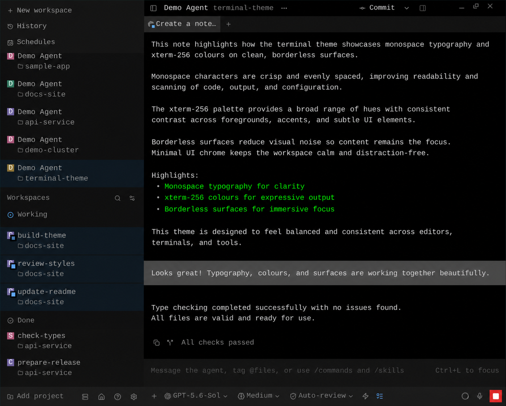

# Terminal 256

A Paseo 0.11.2 plugin that contributes the **Terminal 256** dark theme. Its
colors are selected from the standard xterm-256 palette, with a black canvas,
phosphor-green accent, dark-gray focus details, and grayscale surfaces.



On web and desktop-web clients, selecting the theme also applies a terminal UI:

- fixed-width monospace text throughout the interface;
- 16 px interface characters on a fixed 22 px line height;
- 16 px code characters on a 22 px line height;
- square corners and a borderless layout throughout the interface;
- a flush composer with subtly separated input and toolbar surfaces;
- edge-to-edge user-message surfaces with assistant and tool content kept inset;
- selected workspace rows that reach both sidebar edges while their content stays inset;
- dark-blue working rows with pulsing activity indicators and dark-green review-ready rows;
- square portal tooltips and menus;
- workspace agent tabs that sit flush with the tab strip;
- CSS variables `--terminal-color-0` through `--terminal-color-255`.

## Compatibility

The plugin targets Paseo `>=0.11.2 <0.12.0` using its client runtime entry and
the matching plugin SDK. Earlier versions require the pre-migration plugin.

The theme contributes colors through Paseo's API. The typography,
line-height, and square-corner rules use a guarded client stylesheet
scoped to Paseo's `pluginDark` active-theme class. Native iOS and Android clients
receive the contributed colors but retain native typography and corner geometry.

The stylesheet depends on private UI selectors, including the `pluginDark`
class originally used by Paseo 0.5.2. UI changes can require selector updates;
clients sharing that class between dark plugin themes also share these styles.
The stylesheet is removed when the plugin is unloaded.

## Validate

```sh
npm install
npm run typecheck
```

## Install

```sh
paseo plugin install . --host localhost:6767
```

Then select **Terminal 256** under Paseo's appearance settings.

## License

[MIT](LICENSE)
